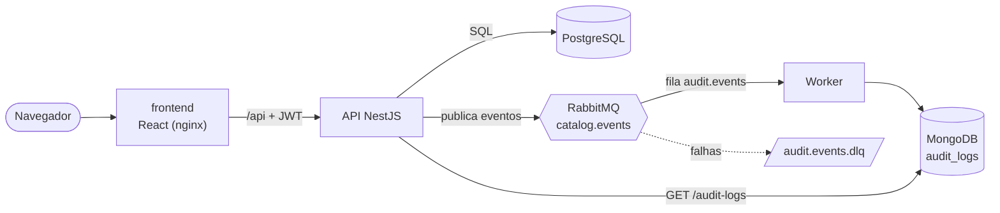
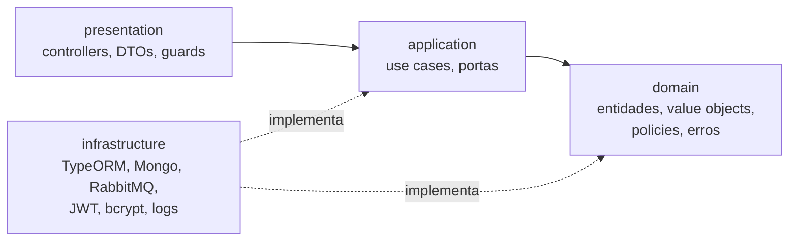
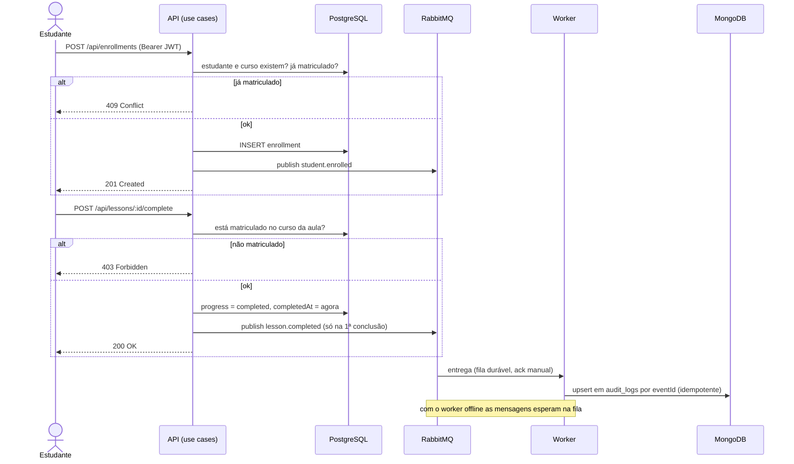

# Catálogo de Cursos 2.0

Plataforma de cursos (cursos, aulas, matrículas e progresso) com **API NestJS** em Clean Architecture/DDD
e **frontend React**, usando JWT com roles, PostgreSQL, MongoDB (auditoria) e RabbitMQ (eventos).

| Pasta | O que é |
| ----- | ------- |
| [`catalog-api/`](catalog-api) | API REST NestJS + TypeScript, worker de eventos e Docker Compose |
| [`frontend/`](frontend) | SPA React + Vite + TypeScript para visualizar e operar o sistema |

📖 **Swagger:** http://localhost:8080/docs (Docker) ou http://localhost:3000/docs (dev local)

## Arquitetura



Dentro da API as dependências apontam para o domínio; a infraestrutura implementa as portas:



## Fluxos principais



## Como rodar

### Tudo com Docker (um comando)

```bash
docker compose up --build
```

Na raiz do projeto, sem configurar nada. Sobem `postgres`, `mongo`, `rabbitmq`, `migrate`
(migrations + seed), `api`, `worker` e `web`.

| Serviço | Endereço |
| ------- | -------- |
| Frontend | http://localhost:8080 (`WEB_PORT`) |
| API / Swagger / saúde | http://localhost:3001 · `/docs` · `/health` (`API_PORT`) |
| Painel do RabbitMQ | http://localhost:15672 (guest/guest) |

Login inicial: **admin@example.com / Admin123!** (`ADMIN_EMAIL` / `ADMIN_PASSWORD`). Para usar outro
segredo JWT: `JWT_SECRET=... docker compose up --build`. `docker compose down -v` apaga os dados.

### Desenvolvimento local

```bash
# API (SQLite + Mongo local)
cd catalog-api
npm install
cp .env.example .env                                  # ajuste JWT_SECRET
docker run -d --name catalog-mongo -p 27017:27017 mongo:7
npm run migration:run && npm run seed
npm run start:dev                                     # http://localhost:3000

# Frontend (outro terminal)
cd frontend
npm install
npm run dev                                           # http://localhost:5173
```

O Vite repassa `/api`, `/health`, `/metrics` e `/docs` para `API_PROXY_TARGET`
(padrão `http://localhost:3000`). Sem `RABBITMQ_URL` a auditoria é gravada direto no Mongo; para
usar a fila, suba o RabbitMQ, defina `RABBITMQ_URL` e rode `npm run start:worker`. Se o Mongo ou o
RabbitMQ estiverem fora, a API continua no ar com `/health` em `degraded` e reconecta sozinha.

### Testes

```bash
cd catalog-api && npm test     # 55 testes: unitários + e2e (SQLite em memória + Mongo em memória)
cd frontend && npm test        # utilitários (JWT, query string, métricas)
```

Com `TEST_DATABASE_URL=postgres://...` a suíte da API roda contra um PostgreSQL real.

## Frontend

- **Estudante:** catálogo com busca e filtro, matrícula, lista de aulas com "Concluir", barra de
  progresso por curso e "Meu aprendizado".
- **Admin:** CRUD de cursos, aulas, estudantes e matrículas; relatório de matrículas por curso;
  auditoria com filtros (evento, estudante, período); painel com indicadores e atividade recente.
- **Sistema:** saúde de cada componente (atualiza a cada 10 s) e tráfego por rota lido do `/metrics`.

## API em resumo

Todas as rotas usam o prefixo `/api` e exigem `Authorization: Bearer <token>`, exceto
`/health`, `/metrics`, `/docs`, `POST /api/auth/register` e `POST /api/auth/login`.

| Recurso | Rotas | Acesso |
| ------- | ----- | ------ |
| Auth | `POST /auth/register`, `POST /auth/login` | público |
| Cursos | `GET /courses?search=&category=&page=&limit=`, `GET /courses/:id` | autenticado |
| | `POST/PUT/DELETE /courses` | ADMIN |
| Aulas | `GET /courses/:id/lessons` · `POST /courses/:id/lessons` (ADMIN) | autenticado |
| Progresso | `POST /lessons/:id/complete`, `GET /students/:sid/courses/:cid/progress` | o próprio estudante ou ADMIN |
| Matrículas | `POST /enrollments`, `GET /students/:id/enrollments` | o próprio estudante ou ADMIN |
| | `GET/DELETE /enrollments` | ADMIN |
| Estudantes | CRUD em `/students` | ADMIN |
| Relatórios | `GET /reports/courses/enrollments` | ADMIN |
| Auditoria | `GET /audit-logs?event=&studentId=&from=&to=` | ADMIN |

Erros sempre no formato `{ message, details?, path, timestamp, requestId }`:
400 validação · 401 sem token/credenciais · 403 role ou dono · 404 inexistente ·
409 e-mail ou matrícula duplicados · 413 corpo grande · 429 rate limit · 503 `/health` com banco fora.

## Destaques técnicos

- **DDD + Clean Architecture:** entidades que se validam (`Course`, `Lesson`, `LessonProgress`),
  value object `Email`, policies de domínio (matrícula duplicada, progresso só para matriculados).
- **Segurança:** guards globais JWT + roles, bcrypt, helmet, rate limiting, `ValidationPipe` estrito,
  SQL sempre parametrizado, filtros Mongo com `$eq`, `.env` validado na subida. `npm audit --omit=dev`: 0.
- **Eventos:** RabbitMQ com mensagens persistentes, publisher confirms, DLQ e consumer idempotente.
- **Dados:** migrations para SQLite e PostgreSQL, índices medidos e relatório em uma query (`LEFT JOIN` + `GROUP BY`).
- **Streams:** `npm run import:lessons -- samples/lessons.csv` importa CSV em lotes
  (300 mil linhas com heap de 64 MB).
- **Observabilidade:** logs JSON (pino) com `requestId`, `/health` por componente e `/metrics` Prometheus.

## Licença

MIT — veja [LICENSE](LICENSE).
